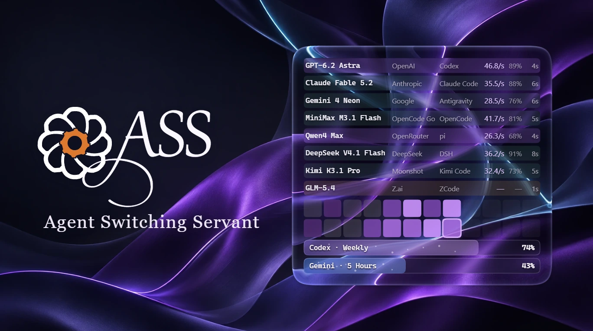

# ASS



*使用设置预览的同一背景与折射渲染，展示八个客户端的示例请求、供应商、用量和额度。折射边缘为 64 DIP，圆角为 48 DIP。*

ASS（Agent-Switching-Servant）是 Windows 桌面的 AI 路由与账户助手。用一个界面管理 AI 客户端、模型供应商和订阅额度，查看本地 Token 用量与实时请求。

[下载 Windows x64 安装包](https://github.com/CaT-Hode/ASS-Agent-Switching-Servant/releases/latest) · [更新记录](docs/CHANGELOG.md) · [设置说明](docs/SETTINGS.md)

## 液态玻璃请求悬浮窗

将正在运行和近期完成的请求放在桌面一角，边工作边看模型、供应商、可见输出 TPS、缓存命中率和耗时。实际请求行来自 ASS 路由及 Antigravity 原生观测。悬浮窗保持置顶并可拖动。Windows 原生模块实时采样窗后画面，在玻璃边缘产生清晰折射，请求条目使用局部磨砂。桌面内容变亮或变暗时，悬浮窗切换对应配色。

在 **设置 → 请求悬浮窗** 打开悬浮窗。可使用液态玻璃滑条或数值输入调整宽度、圆角和最多显示的请求行数。「液态玻璃」分组可单独调整折射边缘的宽度和背景扭曲的幅度。拖动时右侧预览即时更新，松手后将设置应用到桌面悬浮窗。

- 「显示内容」中的 **客户端（Harness）** 列默认关闭，开启后可查看已识别的发起客户端。「供应商」列可独立开关，显示实际处理请求的简短名称。可见输出 TPS、缓存命中率和耗时也可分别显示或隐藏。模型与状态始终保留。
- **今日 Token 热力图**用 24 个格子表示本地时间的 24 个小时。悬停可查看该小时的输入和输出。也可单独开启今日 Token 汇总。
- **订阅额度条**最多显示两条。每条可独立选择已查询到的 Codex、Claude Code 或 Antigravity 订阅窗口，例如 Codex 每周额度和 Antigravity Gemini 5 小时额度。半透明磨砂额度条排在热力图下方，关闭热力图后也能单独显示。

在悬浮窗内按 `Esc` 或使用右键菜单关闭。[悬浮窗设置与数据说明](docs/REQUEST-WIDGET.md)

## 快速开始

1. 从 [GitHub Releases](https://github.com/CaT-Hode/ASS-Agent-Switching-Servant/releases/latest) 下载 `ASS-v<版本>-win32-x64-setup.exe`，安装后从开始菜单打开 ASS。需要使用的 AI 客户端请先自行安装。
2. 打开 **设置 → 客户端**，选择要接入的客户端，在「程序入口」点击「自动识别」。也可以手动选择安装目录或启动文件，并设置默认工作目录。
3. 在 **供应商与模型** 点击「添加供应商」，填写 API 地址和 Key，再读取模型目录或手动添加模型。已有 ASS 供应商 JSON 时，通过 **设置 → 用量与数据** 导入。
4. 在 **客户端与账户** 选择客户端，到「供应商接入」选取要使用的模型，开启「ASS 接入」。修改已接入的模型、协议或默认模型后，点击「应用待同步更改」，确认预览中的生效范围。
5. 打开新的客户端会话，选择接入的模型。客户端的旧进程若缓存配置，可正常退出后重新打开。

模型列表中的闪电按钮可以测试单个模型，模型详情可检测工具调用和思维参数。**连接诊断**支持批量测试、查看延迟与失败原因。测试会发出短模型请求。

## 客户端与模型接入

| 客户端 | 账户与模型能力 |
| --- | --- |
| Codex | ChatGPT OAuth 与订阅额度、OpenAI API、ASS 路由、默认模型和无账号启动 |
| Claude Code | Claude OAuth 与订阅额度、Anthropic API、ASS 路由、CLI 默认模型和 Auto Mode 审查模型 |
| Antigravity | Windows App、IDE 和 CLI 的安装识别与原生登录状态，订阅额度与点数。支持独立模型窗口、CLI Gateway、原生观测和个人窗口 MCP |
| OpenCode | 原生账户、Go / Zen API、本机模型目录和第三方模型接入 |
| pi | 兼容的本机 OAuth、第三方模型接入与 WSL 同步 |
| DeepSeek Harness | DeepSeek API 余额、模型目录、第三方模型接入和插件日账本 |
| Kimi Code | 新旧 CLI、原生 API / OAuth、编程额度和加量包、第三方模型接入 |
| ZCode | CLI 与 Windows 桌面入口、原生 API / OAuth、Start / Coding Plan 额度、第三方模型接入 |

在「供应商接入」可搜索模型、按模型纳入或排除、批量处理筛选结果，并预览模型、协议、默认项和 Windows / WSL 生效范围。按客户端保存选择，有单独的刷新与「恢复上次已应用配置」入口。ASS 路由支持 OpenAI Responses、Anthropic Messages 和 Chat Completions，模型可选择自动识别或指定协议。Kimi Code 等原生直连场景依客户端的配置和协议运行。[原生配置说明](docs/NATIVE-CONFIG.md) · [Kimi Code 与 ZCode 接入](docs/ADDITIONAL-HARNESSES.md)

### Codex 与 Claude Code

- **Codex** 常规接入保留官方登录、原生归档和提示词预测。启用「无账号启动」后，可使用由 ASS 转发的第三方模型，会话继续使用 `openai` provider。原生提示词预测依赖 ChatGPT 登录。遇到旧会话无法续聊或预测失效时，可正常退出 Codex 后使用对应的修复入口。
- **Claude Code** 可指定 CLI 默认模型和 Auto Mode 审查模型，两者可来自不同供应商。审查模型留空时跟随当前终端模型。支持原生 Messages 的模型继续使用 Messages，其他模型可根据接入设置进行协议转换。可从客户端页启动默认模型终端，Claude 桌面版也有 Gateway 入口。
- **模型名与上下文**。Codex 和 Claude Code 的模型显示为 `ASS_<供应商标识>::模型`；其他客户端的受管供应商标识使用小写 `ass-` 前缀。上下文达到 1M 的 Claude Code 模型会显示 `[1m]`，上游请求使用供应商原始模型名。ASS 将自动压缩阈值设为原始上下文的 90%，根据客户端分别写入独立阈值或缩减后的可用窗口。

### Antigravity

在 **客户端与账户 → Antigravity** 查看原生登录、订阅窗口、剩余点数和本机对话，续聊由原生 CLI 打开。使用 **独立模型启动** 可在单独的 Antigravity 桌面窗口或终端中选择已接入模型，个人 Google 账号窗口可以并行使用。

官方账号窗口可通过 `ass-router` MCP 调用 ASS 模型。监听本机 App、IDE 和 CLI 的 Transcript 可在调用结束后记录用量，开启「原生监控 Hook」则可补充实时进行中状态。[Antigravity 接入与能力](docs/antigravity-native.md)

### WSL

Codex、Claude Code 和 pi 可将 Windows 上已应用的接入同步到正在运行的 WSL 发行版。在 **设置 → 客户端** 检测、选择发行版或关闭自动同步，发行版内需安装 Python 3 和对应客户端。供应商接入区的 **WSL** 开关可逐供应商控制同步范围。ASS 处理路径转换和 Windows 本机路由转接，现有 Linux 会话、权限与工具配置会保留。

## 用量、额度与请求监控

| 在哪看 | 数据来自哪里 | 可做什么 |
| --- | --- | --- |
| **路由总览 → 活跃趋势 / Token** | Windows、正在运行的 WSL 和已知项目中的本地会话 / 用量账本 | 按本周、本月、近一年查看，按客户端或模型分类，点击热力格、Token 柱或分类行下钻到项目与会话 |
| **路由总览 → 账户与额度** | 各账户上次成功查询的订阅额度或 API 余额 | 单独刷新账户，查看数据来源、时间与重置时间，关注窗口和查看额度历史 |
| **请求监控** | 经过 ASS 路由的请求与 Antigravity 原生观测 | 查看进行中与历史请求，按时间、模型、供应商、客户端和状态筛选，查看模型或供应商汇总 |

### 本地 Token

ASS 只读扫描已知客户端和项目目录中的用量元数据，按会话、消息或响应标识去重。Codex 兼容旧累计事件和新版逐响应记录，Antigravity 支持 App、IDE 与 CLI 的本地 Transcript。总 Token 为输入与输出之和，缓存读取属于输入，推理属于输出。仅记录到日的账本归入日合计。刷新本地用量可立即更新已知来源并继续发现项目，停止运行的 WSL 留用上次已读的数据。[本地用量来源与计数规则](docs/USAGE-OVERVIEW.md)

### 订阅额度

- **Codex** 按接口返回的窗口展示剩余比例和重置时间。Credits 与可用重置次数分别显示，重置凭证可展开查看各自的到期时间。
- **Claude Code** 展示接口返回的短时、每周及模型专属额度，额外付费用量单列。
- **Antigravity** 按 Gemini 与 Claude / GPT 等模型组展示额度窗口、重置时间和剩余点数。

订阅百分比按账户与额度窗口独立展示。API 余额使用供应商给出的币种或单位。低额度提醒可在 **设置 → 用量与数据** 开启，使用最近 15 分钟内仍在有效周期的查询。额度历史、用量走势和预估均基于实际读数。

### 请求详情

路由请求有 ASS 请求 ID，详情可查看上游请求 ID、HTTP 状态、失败阶段和原因。可见输出 TPS 按文本与工具参数的接收区间计算，缺少独立计时时显示 `—`。不足一秒的速率样本标为「短样本」，在悬浮窗中带 `*`，汇总时剔除。全程吞吐、推理 Token 和首输出时间另列。

Antigravity 的原生记录标为「已观测」。这类记录参与请求数和 Token 汇总。HTTP 状态、首输出和可见 TPS 以实际可取得的数据为准，路由成功率只使用经过 ASS 的请求。开启原生 Hook 后，进行中的原生调用可以显示已过时间。

详细记录最多保留最近 200 条，可按 ASS 或上游请求 ID 检索。较早记录按分钟归档，趋势与汇总包含归档统计。请求监控只记录请求元数据与用量。

## 对话管理

在 **对话管理** 按客户端和项目搜索、预览、置顶、归档、删除或续聊本地对话。「历史与存储」管理 ASS 已保存的副本。启用项目同步后，支持的客户端可轮流续聊已同步的文本上下文，分叉各自保留。删除对话只处理对应会话记录，项目代码目录仍可使用。[项目对话与同步范围](docs/PROJECT-CONVERSATIONS.md)

## 设置与数据

| 入口 | 可配置项 |
| --- | --- |
| **常规** | 浅色、深色、跟随系统和开机启动 |
| **请求悬浮窗** | 显示开关、实时预览、尺寸、折射边缘宽度和扭曲幅度、统计列、热力图、今日 Token 汇总和订阅额度条 |
| **客户端** | 默认工作目录、程序入口、凭据检测目录、Kimi 配置版本和 WSL 同步 |
| **用量与数据** | 低额度提醒、供应商配置导入导出与数据目录 |
| **版本与更新** | 检查更新、自动检查、预览版本、下载安装包和版本说明 |

默认数据目录为 `%APPDATA%\AI Switch Servant`。导出的供应商 JSON 默认移除密钥和额外请求头。关闭主窗口后，ASS 继续在系统托盘运行；使用通过 ASS 转发的模型时请保持 ASS 运行。安装更新前可结束任务并从托盘退出。[设置说明](docs/SETTINGS.md)

## 从源码运行与打包

使用 Node.js 24 和 npm。构建 Windows 原生桌面玻璃与安装包需要 Visual Studio C++ Build Tools、CMake 和 Windows SDK。

```powershell
npm ci
npm run build
npm run build:native
npm start
```

在 Windows x64 上执行 `npm run package` 构建程序和安装包。程序目录为 `release/v<版本>/ASS-win32-x64/`，安装包为 `release/ASS-v<版本>-win32-x64-setup.exe`，同目录生成 SHA256 校验文件。

ASS 使用 [MIT 许可证](LICENSE)。
